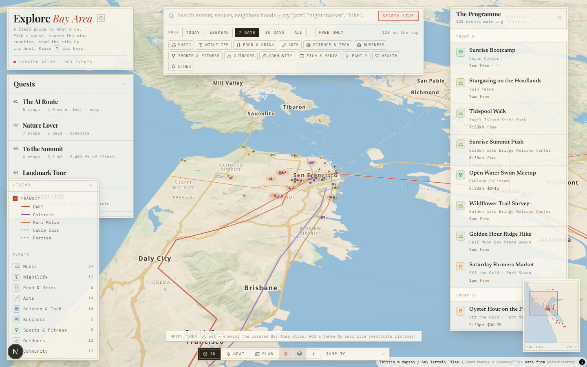
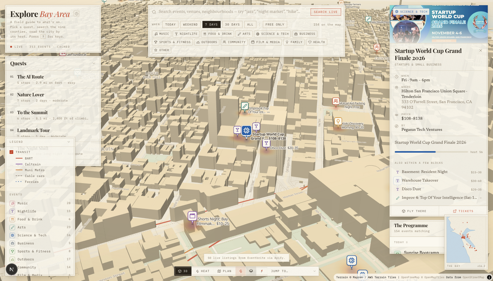

# Explore Bay Area

This project was built during Anthropic's **Claude Fable 5.1 Build Day**, held on September 19, 2026, in San Francisco.

An interactive field guide to everything happening across the nine-county Bay
Area, drawn on a three-dimensional plate of the region.

Not a tech-events board — music, food, trails, galleries, street fairs, kids'
mornings, club nights and conferences all land on the same map, and you narrow
it down by category, date, price or free-text search.



Down at street zoom the buildings extrude and a pin opens into the full
listing — here a live Eventbrite event pulled through Apify, with its real
venue, date, price range and organiser:



---

## What's in it

**A real 3D map.** MapLibre GL over OpenStreetMap vector tiles, with
terrarium-encoded elevation driving actual terrain and extruded buildings at
street zoom. The basemap style is hand-written rather than borrowed, so the
palette holds together from the whole-bay view down to a single block.

**A heat layer.** Every event carries a `heat` score derived from organiser
reach, how free it is, and how soon it starts. The heatmap weights on that, so
the wash shows where the evening is actually happening rather than just where
the pins are dense.

**Category pins.** Thirteen categories, each with its own glyph drawn onto a
marker sprite at runtime — paper chip, coloured keyline, upright in 3D. Labels
with title and price fade in past zoom 13.6 and drop out automatically when the
view gets crowded.

**Quests.** Six curated routes — The AI Route, Nature Lover, To the Summit,
Landmark Tour, The Night Shift, Eat the Bay. Picking one draws the route,
numbers the stops, flies the camera to its framing, and narrows the map to the
categories that quest cares about.

**Transit.** BART, Caltrain, Muni Metro, cable cars and ferries as a toggleable
overlay, so you can tell at a glance whether you can actually get there.

**Three view modes.** 3D (terrain + buildings), Heat (flattened, heat leading),
and Plan (straight-down). Plus a minimap, a legend with live per-category
counts, and keyboard shortcuts throughout — press `?`.

---

## The data

Two layers, merged.

### Live — Eventbrite via Apify

`src/lib/apify.ts` calls the [`hypebridge/eventbrite-search`][actor] Actor,
which scrapes Eventbrite search and discovery pages. Category filters and the
search box become Eventbrite browse URLs (`/d/ca--san-francisco/music/`), and
the Actor returns each listing with coordinates, taxonomy, pricing and
organiser stats. `src/lib/normalize.ts` folds that into the app's own shape and
drops anything it cannot place honestly: events outside the Bay Area bounding
box, events whose `venueCountry` is not `US` (Eventbrite search leaks foreign
listings, and the scraper hands those back with a placeholder San Francisco
coordinate that would otherwise pass the box check), and online events with no
venue at all rather than inventing a downtown pin for them.

**This Actor is paid: from $3.00 per 1,000 results, i.e. $0.003 each.** Three
things keep that in hand:

| Guard | Where | Default |
|---|---|---|
| `maxEvents` — caps the Actor's work | Actor input | 60 |
| `maxTotalChargeUsd` — caps the bill | **call options**, not input | $0.50 |
| TTL cache — stops reloads re-running | in-process | 30 min |

The bill cap belongs in the call's options argument. Put it in the input object
and it is not a cap at all, just an unrecognised field.

A live search is only ever triggered by the **Search live** button or the first
page load — typing, filtering and panning all work against data already in the
browser, and cost nothing.

### Curated — the Bay Area atlas

107 hand-placed real venues (`src/lib/venues.ts`) from The Fillmore to Point
Reyes, each with coordinates, city and plausible categories. A seeded generator
spawns 2–5 events per venue across the next 30 days, deterministic per day, so
the map is dense and good-looking before any token exists — and stays dense
behind sparse live results.

Without `APIFY_TOKEN` the app runs entirely on this layer and says so in the
masthead.

[actor]: https://apify.com/hypebridge/eventbrite-search

---

## Running it

```bash
npm install
cp .env.example .env.local   # optional — add APIFY_TOKEN for the live layer
npm run dev
```

Open http://localhost:3000.

No map token is needed. Tiles come from [OpenFreeMap][ofm] and terrain from
[AWS Terrain Tiles][awsterrain], both free and keyless. The terrain bucket
serves no CORS headers, so `/api/terrain/[z]/[x]/[y]` proxies it same-origin
and caches hard.

[ofm]: https://openfreemap.org
[awsterrain]: https://registry.opendata.aws/terrain-tiles/

---

## Layout

```
src/
  app/
    page.tsx                     orchestrator — all state lives here
    api/events/route.ts          merges live + curated, never throws at the client
    api/terrain/[z]/[x]/[y]/     CORS proxy for elevation tiles
  components/
    MapCanvas.tsx                MapLibre: terrain, buildings, heat, pins, quests
    FilterBar · QuestPanel · Legend · MiniMap · EventList · EventDetail
  lib/
    apify.ts        Actor call, spend caps, cache
    normalize.ts    scraper output → BayEvent
    mapStyle.ts     the parchment basemap
    sprites.ts      category markers drawn to canvas at runtime
    venues.ts       the 107-venue atlas
    seed.ts         deterministic curated events
    quests.ts       the six routes
    transit.ts      BART / Caltrain / Muni / cable / ferry geometry
```

## Keys

`/` search · `1` `2` `3` view modes · `H` heat · `B` buildings · `T` transit ·
`L` programme · `R` reset camera · `Esc` deselect · `?` help
